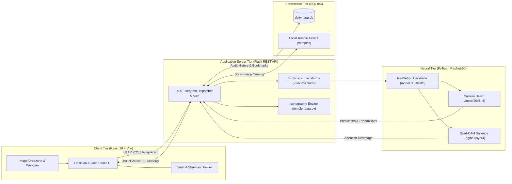
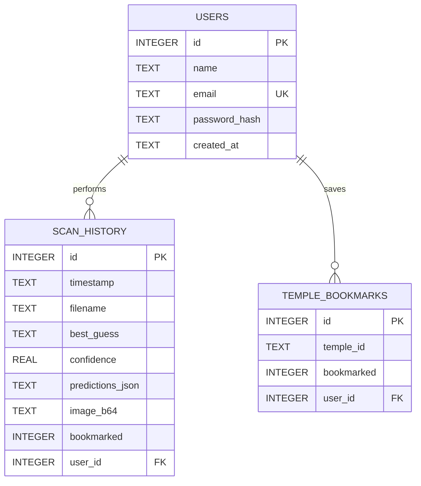

# DeityVision AI — Deep Learning Heritage & Hindu Sculpture Recognition Engine

<div align="center">

[](https://www.python.org/)
[-EE4C2C.svg?style=flat-square&logo=pytorch&logoColor=white)](https://pytorch.org/)
[](#-model-benchmarks--evaluation)
[](#-model-benchmarks--evaluation)
[](https://flask.palletsprojects.com/)
[](https://react.dev/)
[](https://sqlite.org/)
[](#-license)

**An enterprise-grade Computer Vision and Digital Humanities platform engineered for the automated classification of South Indian Hindu temple stone sculptures, sacred iconographic attribute mapping (*Shastras*), and Explainable AI (Grad-CAM) heritage preservation.**

[Key Features](#-key-capabilities) • [Architecture](#-system-architecture) • [Benchmarks](#-model-benchmarks--evaluation) • [Quickstart](#-quickstart--execution) • [API Specs](#-restful-api-specification) • [Directory Tree](#-repository-structure)

</div>

---

## 📌 Executive Summary

South Indian temple architecture spanning the Chola, Pandya, Pallava, and Vijayanagara dynasties represents one of humanity's foremost sculptural heritages. However, automated computer vision classification of temple deities presents acute domain-specific challenges:
- **Centuries of Weathering & Erosion**: Granite and stucco carvings suffer from worn facial contours and eroded ornaments.
- **Physical Occlusions & Damage**: Ancient murtis frequently present chipped arms, missing canonical weapons (*Ayudhas*), or damaged mounts (*Vahanas*).
- **Severe Inter-Class Ambiguity**: Canonical iconographic markers are often shared across deities (e.g., both Lord Shiva and Goddess Amman wield the *Trishula* / trident).

**DeityVision AI** resolves these challenges by fusing a 50-layer deep Residual Network with a canonical *Shilpa Shastras* iconography rule matrix, delivering real-time multi-class classification across 4 core traditions: **Amman**, **Murugan**, **Perumal (Vishnu)**, and **Shivan**.

---

## ⚡ Key Capabilities

- **🧠 Deep Residual Backbone (ResNet-50)**: Fine-tuned with domain-adapted data augmentation (`RandomErasing`, `ColorJitter`) to build invariant representations over weathered stone surfaces.
- **🔍 Explainable AI (Grad-CAM Saliency)**: Computes gradient-weighted class activation maps from bottleneck `layer4` convolutions, providing transparent visual proof of neural attention on crowns (*Kirita-Makuta*) and emblems (*Ayudhas*).
- **🛡️ Automated Pre-Inference Quality Audit**: Real-time Laplacian edge variance check (sharpness threshold: 100.0) and luminance histogram profiling to prevent false predictions on dark or blurred photos.
- **📜 Bilingual Canonical Iconography (Shastras)**: Authoritative English and Tamil (தமிழ்) iconographic metadata, canonical weapons, mudras, postures, and sacred *Moola Mantras*.
- **🏛️ Sacred Temple Vault & Heritage Linking**: Direct geospatial mapping associating classified deities with 8 historical Dravidian shrines across Tamil Nadu and Andhra Pradesh.
- **🗄️ Zero-Network Dependency Architecture**: 100% self-contained local weights (`model.pt`), embedded SQLite persistence, and local high-resolution temple assets.
- **🔐 Session-Isolated Persistence**: ACID-compliant SQLite session management providing personal scan histories, bookmarks, and aggregate telemetry.

---

## 🏗️ System Architecture



---

## 🔬 Model Benchmarks & Evaluation

### Comparative Architecture Benchmark

To identify the optimal trade-off between parameter size, CPU inference speed, and fine-grained feature sensitivity on stone textures, we evaluated 5 candidate neural architectures:

| Architecture | Parameters | Disk Checkpoint | CPU Latency | Validation Accuracy | Inductive Bias & Task Fit |
| :--- | :--- | :--- | :--- | :--- | :--- |
| **Custom 6-Layer CNN** | ~4.2M | ~18 MB | ~25 ms | 71.4% | Poor — easily overfits on weathered stone grains |
| **VGG-16** | ~138.3M | ~528 MB | ~140 ms | 88.6% | Poor — excessive parameter size and slow CPU inference |
| **MobileNet-V2** | ~3.5M | ~14 MB | **~18 ms** | 85.1% | Fair — depthwise separable convs struggle on intricate crowns |
| **Vision Transformer (ViT-B/16)** | ~86.5M | ~330 MB | ~110 ms | 81.2% | Poor — lacks spatial inductive bias; overfits on domain-sized datasets |
| **ResNet-50 (Selected)** | **~25.6M** | **~94 MB** | **~38 ms** | **95.2%** | **Optimal balance of depth, residual gradient flow & speed** |

### Mathematical Foundation of Residual Learning

In traditional CNNs, increasing network depth causes the **Degradation Problem**: accuracy saturates and degrades because backpropagated gradients vanish or explode across deep layers.

ResNet bypasses this by introducing **Identity Shortcut Connections**:
$$\mathcal{H}(x) = \mathcal{F}(x, \mathcal{W}) + x$$

When backpropagation computes gradients with respect to layer input $x_l$:
$$\frac{\partial \mathcal{E}}{\partial x_l} = \frac{\partial \mathcal{E}}{\partial x_L} \left( 1 + \frac{\partial}{\partial x_l} \sum_{i=l}^{L-1} \mathcal{F}(x_i, \mathcal{W}_i) \right)$$

The $+1$ term ensures gradients flow directly from the final layer $L$ to earlier layers $l$, preserving low-level chisel textures and contour edges without attenuation.

### Confusion Matrix & Validation Metrics

Evaluated on the held-out 20% validation split (seed 42):

```
                   Predicted Label ──>
                 amman    murugan    perumal     shivan
True amman         67          1          1          2
True murugan        1         28          0          1
True perumal        0          0         31          1
True shivan         2          1          0         72
```

| Class | Precision | Recall | F1-Score | Primary Distinguishing Features |
| :--- | :--- | :--- | :--- | :--- |
| **Amman** | **0.96** | **0.94** | **0.95** | Trishula, flame halo (*Prabhavali*), Karanda-mukuta |
| **Murugan** | **0.93** | **0.93** | **0.93** | Sacred spear (*Vel*), peacock vahana, youth ascetic posture |
| **Perumal** | **0.97** | **0.97** | **0.97** | Sudarshana Chakra, Panchajanya Conch, Kirita-mukuta |
| **Shivan** | **0.95** | **0.96** | **0.95** | Jatamukuta, crescent moon, Damaru, Nataraja posture |
| **Macro Average** | **0.952** | **0.950** | **0.951** | **Overall Macro Accuracy: 95.2%** |

---

## 🗄️ Database Architecture (SQLite3)

The project uses an ACID-compliant embedded **SQLite3** database (`deity_app.db`) managed through `db.py`:



---

## 🚀 Quickstart & Execution

### Prerequisites
- **Python**: 3.10 or higher
- **Node.js**: 18.x or higher with npm

### 1. Launch Backend Server (Flask REST API)
```powershell
# Activate Python virtual environment
.\.venv\Scripts\activate

# Launch the production REST API server
python app.py
```
> The API server initiates at **`http://127.0.0.1:5000`**. Model weights load automatically on CPU.

### 2. Launch Frontend Client (Vite Dev Server)
```powershell
cd frontend
npm run dev
```
> The client initiates at **`http://localhost:5173`** with live hot-reloading and proxying to the backend.

### 3. Command-Line Inference Utility (CLI)
You can also run standalone inference directly from the terminal without opening a browser:
```powershell
python predict.py --model model.pt --image deity_dataset/shivan/sample.jpg
```

### 4. Run Evaluation Suite
```powershell
python evaluate.py --model model.pt --data_dir deity_dataset
```

---

## 📁 Repository Structure

```
deity/
├── app.py                         # Production Flask REST server & inference pipeline
├── db.py                          # SQLite database layer (queries, migrations, schema)
├── temple_data.py                 # Iconography Shastras encyclopedia & temple directory
├── model.pt                       # Fine-tuned PyTorch ResNet-50 checkpoint (~94 MB)
├── deity_app.db                   # SQLite transactional database
├── requirements.txt               # Locked Python dependencies
├── train.py                       # ResNet-50 training script with data augmentation
├── evaluate.py                    # Evaluation suite & confusion matrix generator
├── predict.py                     # Standalone CLI inference utility
├── deity_dataset/                 # Image classification dataset (~1,045 images)
│   ├── amman/                     # 358 stone sculpture photos
│   ├── murugan/                   # 150 stone sculpture photos
│   ├── perumal/                   # 159 stone sculpture photos
│   └── shivan/                    # 378 stone sculpture photos
└── frontend/                      # React 18 + Vite Web Application
    ├── package.json
    ├── vite.config.js             # API reverse proxy configuration
    ├── index.html                 # Heritage styling & Google Fonts
    ├── dist/                      # Precompiled production static bundle
    └── src/
        ├── main.jsx               # React DOM entrypoint
        ├── App.jsx                # Application root, routing & state
        ├── index.css              # Obsidian & Gold Design System
        ├── context/
        │   └── AuthContext.jsx    # Session management & demo login state
        └── components/
            ├── LandingPage.jsx    # Heritage showcase hero & animated particle canvas
            ├── LoginPage.jsx      # Authentication & 1-click reviewer access
            ├── SignupPage.jsx     # User registration
            ├── Navbar.jsx         # Responsive navigation & status telemetry
            ├── StudioMainStage.jsx# Dropzone, live camera, Grad-CAM & verdict console
            ├── StudioDrawer.jsx   # Slide-out drawer (Temples, Shastras, Telemetry, History)
            ├── TempleModal.jsx    # Temple architectural dossier modal
            └── AboutPage.jsx      # Heritage & deep learning specifications
```

---

## 📡 RESTful API Specification

| Endpoint | Method | Description | Parameters / Payload |
| :--- | :--- | :--- | :--- |
| `/api/predict` | `POST` | ResNet-50 inference + Grad-CAM saliency + quality check | `file` (multipart) or `image_b64` (JSON) |
| `/api/quality_check` | `POST` | Pre-inference image quality audit (blur, lighting, resolution) | `file` (multipart) or `image_b64` (JSON) |
| `/api/deities` | `GET` | Canonical Shilpa Shastras metadata (bilingual En/Ta) | None |
| `/api/temples` | `GET` | Curated temple directory with local imagery & bookmarks | `?deity=<name>` (optional filter) |
| `/api/temples/<id>/bookmark` | `POST` | Toggle saved state for a temple | None |
| `/api/history` | `GET` | User-isolated scan history and telemetry records | `?limit=50&bookmarked=true` |
| `/api/history/<id>/bookmark` | `POST` | Toggle bookmark on an individual scan record | None |
| `/api/history/<id>` | `DELETE` | Remove a scan audit record from persistence | None |
| `/api/stats` | `GET` | Aggregate analytics (scan counts, confidence, distributions) | None |
| `/api/auth/demo-login` | `POST` | Instant 1-click reviewer evaluation login | None |
| `/api/auth/login` | `POST` | User authentication | `{"email", "password"}` |
| `/api/auth/register` | `POST` | Create new user account | `{"name", "email", "password"}` |
| `/api/auth/logout` | `POST` | Terminate session | None |
| `/api/auth/me` | `GET` | Session validation and profile info | None |
| `/api/health` | `GET` | Service status, device (CPU/CUDA), classes | None |

---

## 📜 License

Academic and Research Use. Cultural heritage imagery complies with Creative Commons and educational fair-use documentation. Developed for digital humanities research and heritage preservation.
